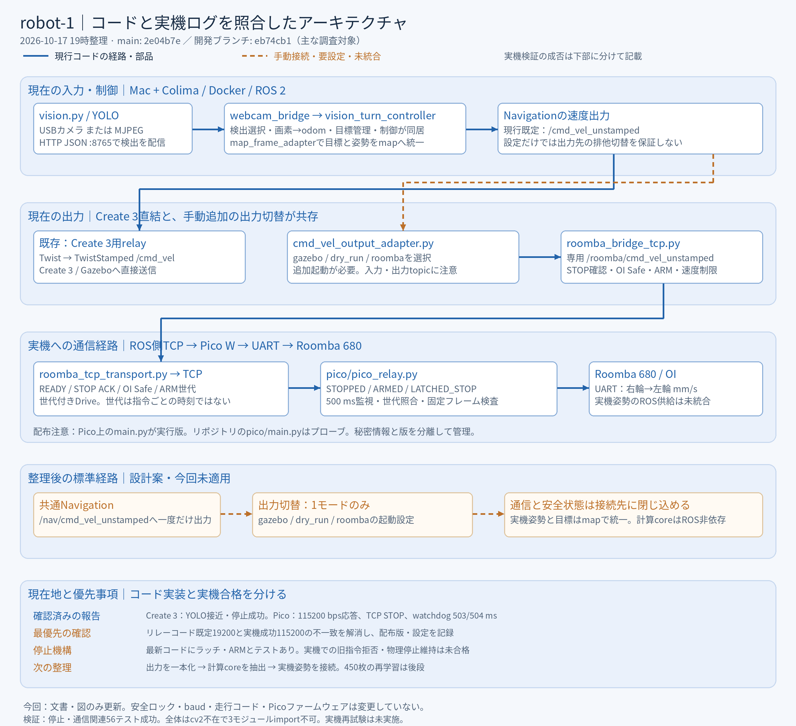
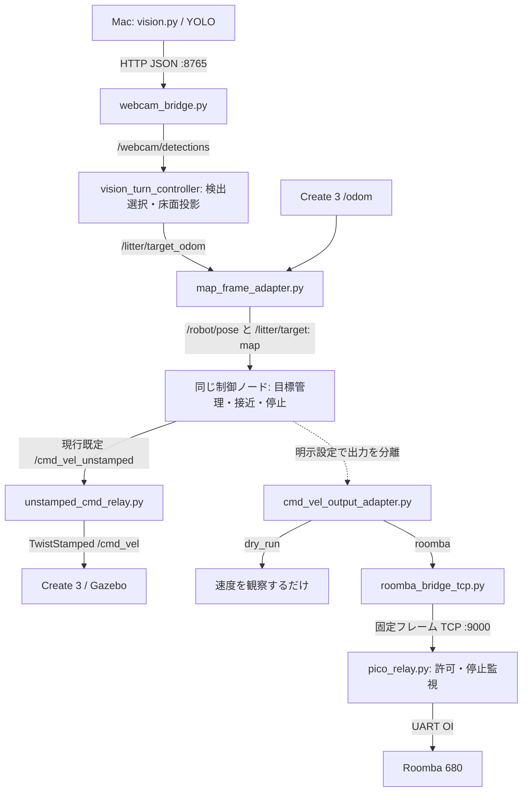
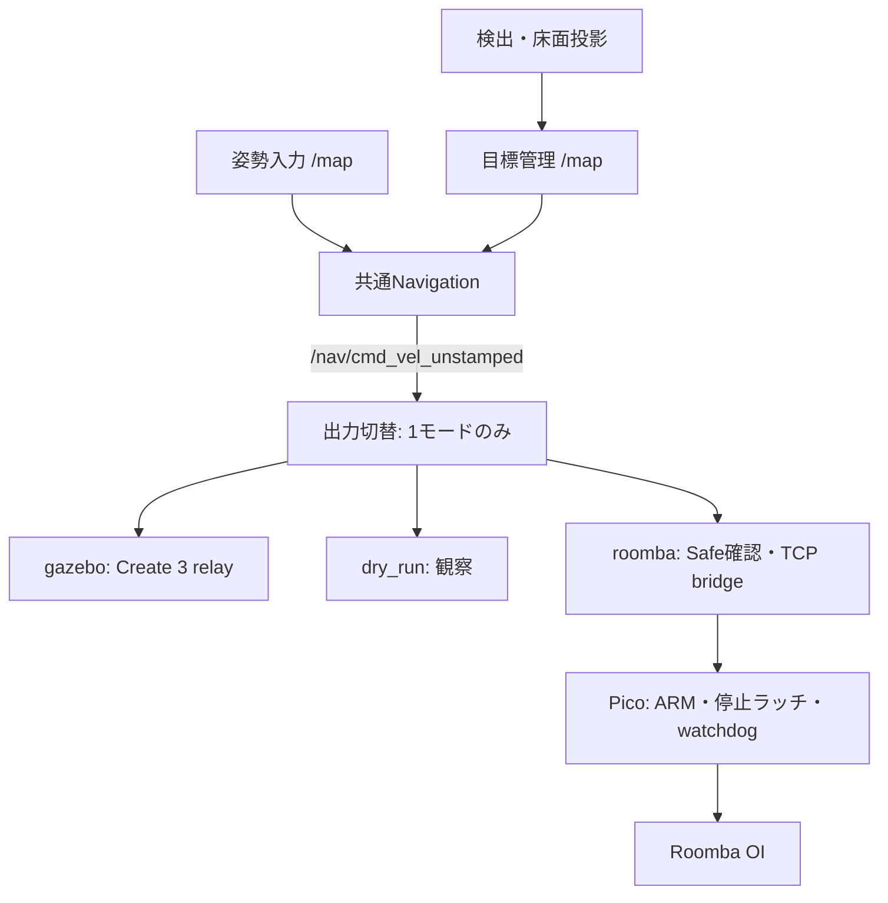
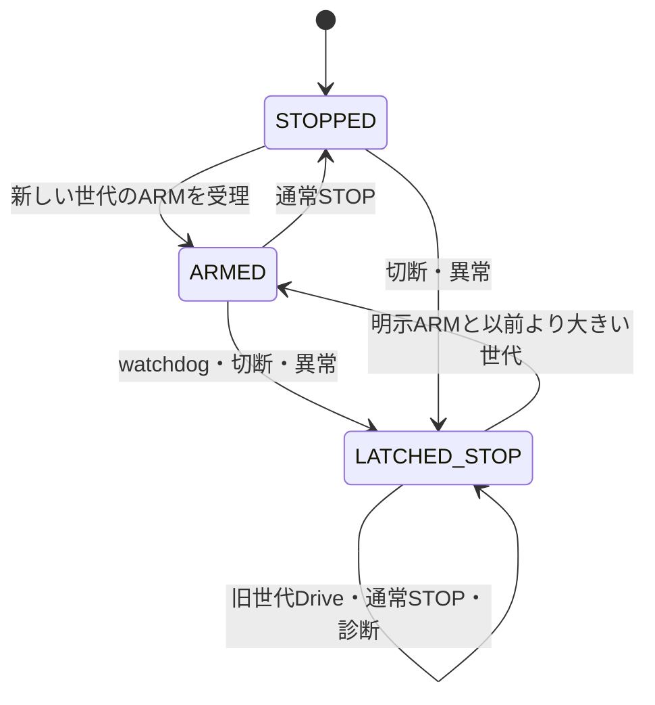

# robot-1 アーキテクチャ整理（2026-10-17）

> 最新の10/20結果・構成・今後の課題は [10/20アーキテクチャ追記](docs/ARCHITECTURE_STATUS_2026-10-20.md) を参照。以下は10/17のコード調査時点の記録です。

現在は「YOLOを含むCreate 3の接近・停止が報告済み」「RoombaのTCP/UART駆動と停止出力が確認済み」「両者の実機自律回収への結合は未完了」という段階である。認識、座標、制御、出力先、走行許可、通信を別の責務として扱う。

この変更は設計文書と図の整理であり、走行コード・配線・安全設定・ファームウェアを書き換えるものではない。

## 1. 調査対象と、コード／ログの読み分け

| 対象 | 参照点 | 位置づけ |
|---|---|---|
| GitHub `main` | `2e04b7e` | 実機ドライバ、姿勢変換、模擬出力、提出用記録ツールを含む |
| `feature/yolo-roomba-dry-run-integration` | `eb74cb1` | 今回の実装調査の主対象。`main`より2コミット先。出力切替、TCPブリッジ、停止ラッチ、ARM世代番号を含む |
| 10/16進捗レポート | 15:14 JST版 | YOLOを含むCreate 3提出候補試行、129テスト、成果物の報告 |
| 10/17 UART経過レポート | 18:15 JST更新版 | 115200 bpsでの応答、watchdog後の旧指令再転送、ラッチ導入方針の報告 |

ログの「ラッチ実装未確認」に対し、開発ブランチには`MotionLatch`とその単体テストがある。したがって**コードは実装済み、Picoへの同一版の書込みと実機での再駆動防止の合格は未確認**と表現する。リポジトリ、Macの作業コピー、Pico上の`main.py`は同じ版とは限らない。

## 2. 現行の実行境界

| 実行場所 | 主な処理・入口 | 境界 |
|---|---|---|
| Mac / Python | `vision.py`、校正・認識評価・学習準備ツール | USBカメラ、またはコンテナのMJPEG映像。検出JSONをHTTP送信 |
| Colima / Docker / ROS 2 Jazzy | `simulation/sim.sh` → Compose → Supervisor、ROSノード、Gazebo | localhostのDDS、HTTP 8765、MJPEG 8766。PicoへはTCP接続 |
| Pico W / MicroPython | 正式なリレーソースは`pico/pico_relay.py` | Wi-Fi TCP 9000 → 許可した固定フレームのみUARTへ送信 |
| Roomba 680 | OI Safe、Drive Direct、センサー | UART。左右輪速度の単位はmm/s、OIの順序は右輪→左輪 |
| Mac / FLINT（予備経路） | `roomba_driver.py` + `odometry.py` | pyserialによる直接UART。ROSのTCP経路と別の通信所有者 |

Supervisorは既存の制御・姿勢変換・Create 3用relay等を起動する。`cmd_vel_output_adapter`と`roomba_bridge_tcp`は追加コマンドで起動する構成であり、コンテナが起動しただけで実機経路が完成するわけではない。

`pico/main.py`は既存の手動UARTプローブで、Wi-Fiリレーではない。リレーは`pico_relay.py`のローカル配布コピーをPico上で`main.py`として保存する。認証情報をリポジトリへ保存せず、配布版のコミット・設定・起動ログを別途記録する。

## 3. 現行の論理フロー

図の投影とNavigationは論理的に分けているが、現行では両方とも`vision_turn_controller.py`内にある。画像→odom→map→制御という往復は、数学的な循環ではなく、同じノードが投影結果を公開し、変換後の目標を購読する構成である。

実機の`/robot/pose`を安定供給するROSアダプターは未完了。ローカルのエンコーダー計算や`odometry_log.csv`だけでは、このトピックが生成されるわけではない。ArUco姿勢ノードも将来案である。

## 4. 各ファイルの責務

| 機能 | 現在の所有者 | 整理する境界 |
|---|---|---|
| 映像取得・YOLO・JSON送信 | `vision.py` | カメラ／推論／HTTPを関数・モジュール単位で分離。起動CLIは維持 |
| 最高信頼度の候補・時刻検証・同一目標保持 | `simulation/target_manager.py` | ROS非依存の目標管理を維持 |
| 画素→床面、角度、速度計算、ROS、表示 | `simulation/vision_turn_controller.py`（438行） | 投影・制御計算をpure coreへ。ROS nodeは入出力・入力寿命・状態管理 |
| odom→mapの数値変換・静的TF | `simulation/map_frame_adapter.py` | 目標と姿勢に同一変換を適用。frame名だけを置換しない |
| 出力先の選択 | `simulation/cmd_vel_output_adapter.py` | `gazebo` / `dry_run` / `roomba`の1つを選択 |
| ROS指令・Safe確認・再接続 | `simulation/roomba_bridge_tcp.py` | ROS層とTCP transportの分離は既にある。通常運転とwatchdog試験を分ける |
| TCPフレーム・ACK・ARM・指令寿命 | `simulation/roomba_tcp_transport.py` | ROS非依存を維持。Picoとのプロトコル仕様の基準にする |
| 差動二輪変換 | `simulation/differential_drive.py` | ここが正本。ルート`differential_drive.py`は互換import済み |
| 模擬左右輪出力 | `simulation/roomba_dry_run_adapter.py` | 独自の二輪計算が残る。正本へ統一し、100 mm/s等の表示用制限を明示 |
| 有線UART・自己位置計算 | `roomba_driver.py` / `odometry.py` | TCP実機経路と分離。実機姿勢アダプターを作るならここから数値を公開 |
| 目標までの距離・角度 | `navigation.py` | `calculate_goal`の正本。`goal_math.py`は互換import済み |
| Pico通信・プロトコル・走行ラッチ・UART | `pico/pico_relay.py`（556行） | parser、状態機械、UART、ネットワークを分ける。ROSやYOLOは持ち込まない |
| 検証・動画・表示 | `*_test.py`、`recording_status.py`等 | ランタイムとは別のツール群。`artifacts/`は試行の証拠 |

前回作成した`vision_app/`・`robot_runtime/`の整理パッチは、今回の調査ブランチには入っていない。その時のファイル配置を現行実装として扱わない。

## 5. データ契約

| 境界 | 型・単位 | Producer → Consumer | 注意点 |
|---|---|---|---|
| `POST /detections` | JSON、画像座標px、`timestamp`はUNIX秒 | `vision.py` → HTTP bridge | 画像サイズ・対象ラベル・時刻を保存 |
| `/webcam/detections` | `std_msgs/String` | bridge → controller | `litter`・confidenceによる候補選択 |
| `/litter/target_odom` | `PointStamped`、m、frame=odom | 投影 → map adapter | ホモグラフィはカメラ配置・解像度に依存 |
| `/robot/pose` | `PoseStamped`、m、frame=map | map adapter → controller | 実機姿勢の差替えは未完了 |
| `/litter/target` | `PointStamped`、m、frame=map | map adapter → controller | 目標と姿勢が同一座標系であること |
| `/litter/reached` | Bool | controller → 記録・表示 | 到達判定。吸引・回収成功を意味しない |
| `/nav/cmd_vel_unstamped` | Twist、m/s・rad/s | controller → 出力切替 | 推奨する統一境界。現行既定では未使用 |
| `/cmd_vel_unstamped` | Twist | 既存controller または出力切替 → Create 3 relay | 複数の速度所有者を同時に置かない |
| `/roomba/cmd_vel_dry_run` | Twist | 出力切替 → 観察 | 車輪駆動を行わない。左右輪表示の旧dry-runとは別物 |
| `/roomba/cmd_vel_unstamped` | Twist | 出力切替 → TCP bridge | これだけで走行許可は成立しない |
| `/roomba/arm_generation` | UInt32 | 明示的な操作 → bridge | 走行用Twistとは別の許可境界 |
| TCP / Pico | 固定フレーム | transport ↔ relay | READY、STOP診断、OI診断、ARM、世代付きDrive |
| UART / Roomba | OI Drive Direct、右・左の符号付き16 bit mm/s | Pico → Roomba | 最新実測115200 bps・8N1。コード既定との差あり |

TCPの世代付きDriveは`D7 05 + generation(uint32 big-endian) + 145/right/left`の11バイト。旧5バイトDriveはSTOPの互換性だけを残し、非ゼロ値を拒否する。ARMは`D7 04 + generation`。診断は固定の許可リストであり、任意OIや任意UARTバイトを転送するAPIではない。

現行の世代番号は走行許可の世代であって、個々の指令のsequenceや送信期限ではない。Twistもヘッダーなしなので、受信時刻が新しいことと、送信元で新しい指令であることを同一視しない。

## 6. 整理後の標準経路（提案、未適用）

整理の中心は**制御結果を一度だけ出し、出力先だけを差し替えること**。NavigationにUART・Wi-Fi・Picoの状態を直接混ぜない。Picoに画像認識・目標選択・ROSを載せない。

現在はcontrollerの既定出力とYAMLが`/cmd_vel_unstamped`で、`sim.sh cmd-adapter`の既定入力も同じ。そのためdry-run adapterを追加しても、既存Create 3への出力は止まらない。`cmd_vel_output_adapter.yaml`の既定入力`/nav/...`とも差がある。

移行時はcontroller出力とadapter入力を`/nav/...`へ同時にそろえ、modeごとの単独起動プロファイルを作る。gazeboモードで入出力を同じトピックにしない。既存の提出用試行を再現できる互換プロファイルを残し、新しい標準を検証してから切り替える。

## 7. 停止を担当する4層

| 層 | 所有する判断 | 現状と限界 |
|---|---|---|
| Navigation | 未校正・入力切れ・到達・対象消失 | 到達ラッチは目標の状態。Picoの停止ラッチとは別 |
| 出力切替 | 指令の非有限値・受信timeout | 既定0.5秒。出力先トピックへSTOP |
| TCP bridge | 走行許可、STOP ACK、OI Safe、指令寿命、再接続 | `drive_enabled=false`が既定。ACK/SafeとARMが必要 |
| Pico | 固定フレーム検査、世代照合、500 ms監視、切断 | `ALLOW_NONZERO_DRIVE=False`が既定。停止状態を保持する最後のソフト層 |

ARMはPico側ロックが開いている場合だけ受理される。bridge側でも有効化・接続・Safe gateを要求する。再接続だけでは許可しない。Picoの`highest_generation`はプロセス内メモリで、電源断をまたぐ永続的な世代管理ではない。

STOP ACKの`0x07`は「Pico検証」「UART書込み」「Roombaの要求左右速度41/42がゼロ」の組合せである。要求速度ゼロはエンコーダーや目視による物理停止確認とは異なる。500 msは実装上の監視設定であり、各種UART診断を同じイベントループで実行するため、全条件での厳密な停止時間保証とはしない。

## 8. コードとログから見つかった整理対象

| 優先度 | 対象 | 根拠・対応 |
|---|---|---|
| P0 | 配布版と通信設定の一致 | 最新実機成功115200に対し`pico_relay.py:BAUD=19200`。`roomba_uart_probe.py`は115200。起動ログにソース版・baud・ロック・プロトコル版を残し、個体ごとの設定へ分離 |
| P0 | ラッチの実機合格 | 10/17ログで旧非ゼロ指令が再転送。最新コードと56件の関連テストにはラッチあり。配布同一性、遅延Drive、再接続、再ARMを含む実機検証が必要 |
| P0 | ARM直後のSTOPの意味 | bridgeの`on_arm()`は保留指令を消し、次の`tick()`は指令なしならSTOPを送ってARMを消す。ARMと最初のTwistの到着順で許可が消え得る。明示状態遷移として扱い、ノードの時系列テストを追加する対象 |
| P1 | 出力所有者の一本化 | 既定controllerはCreate 3へ直結。adapterを追加するだけでは排他切替にならない。`/nav/...`と起動プロファイルを整える |
| P1 | 共通計算の正本 | 二輪変換は一部共通化済みだが旧dry-runに重複。角度・変換もnode間に重複。単位と丸め・制限値を契約にする |
| P1 | 大きな責務の分離 | controller 438行、Pico relay 556行。pure coreを先に切り出し、ROSやMicroPythonとの境界を薄くする |
| P1 | 検証方法の整理 | 一部テストは文字列検査・AST抽出・fake hardware。実関数、node時系列、実機結果を別の検証層にする |
| P2 | ドキュメントの同期 | 既存README・ARCHITECTURE・PAI_SUBMISSIONには古い段階の説明が残る。例：回収モデル未実装、通信adapter未実装という説明は開発ブランチの実装と一致しない |

`generation`があっても、同じARM世代内の遅延指令は識別できない。個別sequence・期限・再ARMの運用は追加設計事項。特に古いARMそのものを自動再送して停止を解除する設計にしない。ここでは実装変更していない。

## 9. 到達点と未完了を分離する

| 項目 | コード・報告に基づく判定 |
|---|---|
| YOLOを含むCreate 3統合試行 | 10/15試行の成功報告あり。confidence 0.7559、269.35秒、停止距離0.150985 m、到達後3.2秒の非ゼロ指令0、hazard0。今回MP4本体は再検証していない |
| 単一／A-B目標・座標変換 | Gazeboでの段階合格報告あり。実機の合格ではない |
| 認識精度全般 | 3対象比較は失敗例あり。1回の統合試行成功と一般的な精度を区別する |
| 450枚の再学習データ | 準備済み。10/16記録では既存モデル維持・再学習後回し。追加の学習成功は未確認 |
| FLINT駆動・オドメトリ | 有線の駆動・エンコーダー取得の成功実績。TCP経路の実機姿勢ROS入力とは別 |
| Pico UART | 最新115200 bpsで`3B 71`を3回受信、電池15.217 Vの報告 |
| TCP STOP・Safe | 送信・検証・UART書込み、Safe=2の報告 |
| watchdog | 503/504 msでSTOPをUART出力したログあり。旧コードで発火後の再駆動防止は未達 |
| 停止ラッチ・世代ARM | 最新開発コードと単体テストに実装。実機への同一版配布・停止保持は未合格扱い |
| 物理停止・電気条件 | 要求速度・UARTログと分けて確認する。1 kΩ直列をレベル変換完了とは扱わない |
| 実機の自律回収 | 未完了。実機姿勢、認識目標、運動・停止、回収動作の統合が残る |

## 10. 整理後のディレクトリ案（未移動）

| 将来の置き場 | 内容 | 現在からの移行 |
|---|---|---|
| `robot_core/` | geometry、navigation、target管理、odometry、二輪変換 | ROS非依存部分から移す。旧importを互換shimで維持 |
| `vision_app/` | capture、detector、detection HTTP client | `vision.py`のCLIを残して委譲 |
| `ros_nodes/` | 投影・姿勢・navigation・出力切替・TCP bridge・可視化 | nodeを責務ごとに分ける。いきなり全て別プロセス化する必要はない |
| `transports/` | TCP protocol/client、USB serial driver | ROSの型をimportしない |
| `firmware/pico/` | protocol parser、motion latch、UART、network、起動 | CPythonのcoreをそのまま持ち込まずMicroPython制約を守る |
| `configs/` | sim、dry-run、roomba、個体別通信・校正 | 個体設定と試行時overrideを分離。認証情報は対象外 |
| `simulation/` | Docker、起動、worlds、models、公式ソース | Docker build contextが現在ここにあることに注意 |
| `tools/` / `tests/` / `artifacts/` | 校正・評価・記録／テスト／証拠 | ルートの`test_*.py`は実機を動かすCLIもあるため、unit testと区別 |

現在のDockerは`simulation/`内のPythonファイルを`/usr/local/bin`へコピーする方式である。ルートに`robot_core`を作るだけではコンテナからimportできない。共通ライブラリをコンテナへ配布する方法を決め、importとDocker COPYを同じ変更で移す。将来の配置を現行構成と混同しない。

## 11. 実装へ移る順序と完了条件

1. **版と個体設定を固定**：実機成功baud、配布元コミット、実際のPicoコード、プロトコルと両ロックの値を記録。電気条件も別の確認項目にする。
2. **停止状態機械を先に検証**：単体テストに加えARM直後の待機、watchdog、古いDrive、再接続、再ARMをnodeとPicoの両側で検証。UARTの非ゼロ再出力0と物理停止維持を別々に記録する。
3. **Navigation出力を一本化**：`/nav/...`からadapterを1つ通し、gazebo/dry-run/roombaの各モードで不要な速度Publisherがいないことを確認する。
4. **pure coreを抽出**：まず二輪変換とgeometry、次にprojection/control。挙動を変えず互換入口と既存試行を維持する。
5. **実機姿勢を差し替え**：校正したエンコーダー推定またはカメラ姿勢をmapにそろえ、固定目標で短距離・停止を確認してからYOLO目標へ進む。
6. **認識改善・提出整理**：再学習は安全経路の優先項目後。固定testで比較し、成功試行と認識の一般精度を分けて記録する。

## 12. 今回の確認範囲

- 分離したworktreeで`eb74cb1`を調査。元の作業コピーの変更は保持。
- `python -m unittest discover -s tests -v`：144件として報告、141成功・3モジュールが`cv2`不在でimportエラー。全件成功ではない。
- 停止・通信・出力切替に絞った4モジュール：56件成功（Pico protocol、TCP transport、ROS bridgeの構造検査、output adapter）。
- ROS/Gazebo、Pico/Roomba、実際の無線・車輪・電圧・提出動画の再実行はしていない。
- 文書・図のみ変更。安全ロック、baud、速度上限、走行コードは変更していない。
