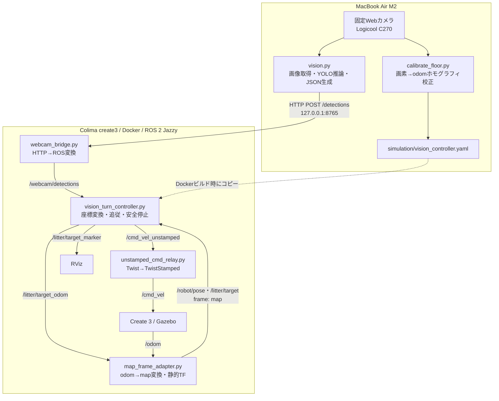
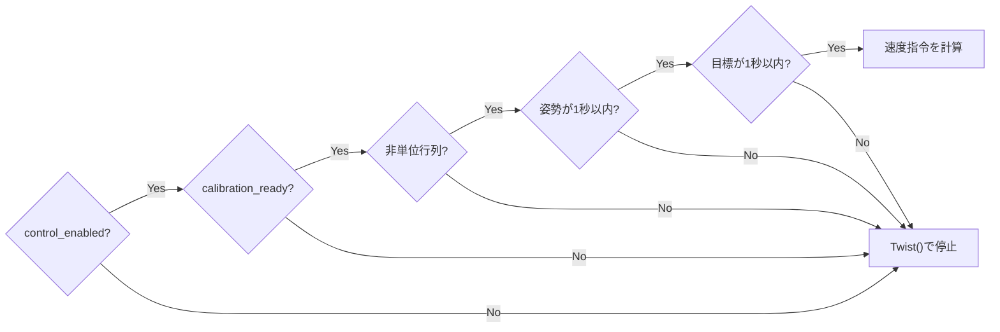
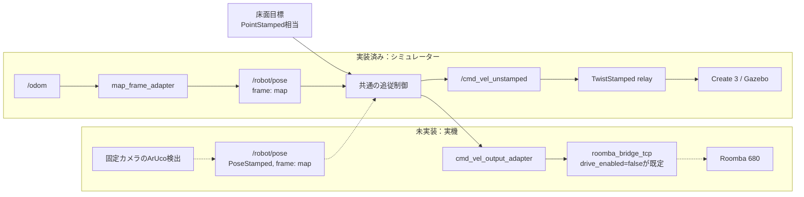

# robot-1 アーキテクチャ

この文書は、現在動作しているシミュレーター経路と、今後追加する実機経路を分けて整理したものです。青写真としての将来案ではなく、リポジトリ内の現行コードを基準にしています。

## 1. システム境界

システムは、固定WebカメラとYOLOを動かすMac側と、ROS 2・Gazebo・Create 3を動かすColima/Docker側に分かれます。



Colima VMにはMacのフォルダをマウントしていません。`vision_controller.yaml`を変更した場合は、`./simulation/sim.sh up`でDockerイメージへ反映します。

## 2. 現在のデータフロー

1. `vision.py`が固定Webカメラの画像を取得します。
2. YOLOが`litter`候補のラベル、信頼度、中心画素、幅、高さを生成します。
3. `vision.py`が画像サイズと検出配列をJSONにして、HTTPでポート8765へ送ります。
4. `webcam_bridge.py`がJSONを`std_msgs/msg/String`として`/webcam/detections`へ配信します。
5. `vision_turn_controller.py`が最高信頼度の`litter`を1件選び、校正済みホモグラフィで画像中心を`odom`床面座標へ変換し、`/litter/target_odom`へ配信します。
6. `map_frame_adapter.py`が同じ`map←odom`剛体変換を`/odom`と`/litter/target_odom`の数値へ適用します。`frame_id`だけを変更する処理ではありません。
7. アダプターが`map`座標の`/robot/pose`と`/litter/target`を配信し、同じ変換を静的TFとしても配信します。
8. 制御ノードが`/robot/pose`と`/litter/target`の位置・角度差を計算します。
9. 安全条件を満たす場合だけ、`/cmd_vel_unstamped`へ`Twist`を送ります。
10. `unstamped_cmd_relay.py`が`TwistStamped`へ変換し、Create 3用の`/cmd_vel`へ中継します。

`/litter/target`をいったんROSトピックとして公開・再購読することで、座標変換結果の可視化と追従制御の入力境界を明確にしています。

## 3. インターフェース一覧

| 境界 | 名前 | 型・形式 | Producer | Consumer | 用途 |
|---|---|---|---|---|---|
| HTTP | `POST /detections` | JSON | `vision.py` | `webcam_bridge.py` | Macからコンテナへ検出結果を渡す |
| ROS | `/webcam/detections` | `std_msgs/msg/String` | `webcam_bridge.py` | `vision_turn_controller.py` | 検出JSON |
| ROS | `/odom` | `nav_msgs/msg/Odometry` | Create 3 / Gazebo | `map_frame_adapter.py` | シミュレーターの元姿勢 |
| ROS | `/litter/target_odom` | `geometry_msgs/msg/PointStamped` | `vision_turn_controller.py` | `map_frame_adapter.py` | `odom`座標系の中間目標 |
| ROS | `/robot/pose` | `geometry_msgs/msg/PoseStamped` | `map_frame_adapter.py` | `vision_turn_controller.py` | `map`座標系のロボット姿勢 |
| ROS | `/litter/target` | `geometry_msgs/msg/PointStamped` | `map_frame_adapter.py` | `vision_turn_controller.py`、確認用CLI | `map`座標系の目標点 |
| ROS | `/litter/target_marker` | `visualization_msgs/msg/Marker` | `vision_turn_controller.py` | RViz | ごみ目標の球表示 |
| ROS | `/litter/reached` | `std_msgs/msg/Bool` | `vision_turn_controller.py` | 確認用CLI、将来の回収処理 | 目標から15 cm以内の到達判定 |
| ROS | `/cmd_vel_unstamped` | `geometry_msgs/msg/Twist` | `vision_turn_controller.py` | `unstamped_cmd_relay.py` | 制御ノードの速度出力 |
| ROS | `/cmd_vel` | `geometry_msgs/msg/TwistStamped` | `unstamped_cmd_relay.py` | Create 3 | シミュレーターへの速度指令 |

検出JSONの概形は次のとおりです。

```json
{
  "timestamp": 0.0,
  "image_width": 1280,
  "image_height": 720,
  "detections": [
    {
      "label": "litter",
      "confidence": 0.9,
      "center_x": 640.0,
      "center_y": 360.0,
      "width": 100.0,
      "height": 80.0
    }
  ]
}
```

## 4. 座標系と校正

画像上の画素座標`(u, v)`と、シミュレーター床面の`odom (x, y)`は直接一致しません。`calibrate_floor.py`で床面の4点を対応付け、3×3ホモグラフィ行列を求めます。

```text
画像中心画素 (u, v)
        │
        │ image_to_odom_homography
        ▼
床面目標 (x, y) in odom
```

校正値の保存先は`simulation/vision_controller.yaml`です。単位行列は未校正として拒否されます。校正時と運用時の画像サイズが設定されている場合、解像度が一致しない入力も拒否されます。

カメラの位置、向き、高さ、画角、解像度を変更した場合は再校正が必要です。

## 5. 追従制御

制御ノードには2つの動作モードがあります。

| モード | 並進 | 旋回 | 使用段階 |
|---|---:|---:|---|
| `turn_only` | 常に0 | 目標方向へ比例制御 | 最初の方向確認 |
| `approach` | 最大0.08 m/s | 目標方向へ比例制御 | 障害物のない範囲での低速接近 |

`approach`でも、角度誤差が`forward_angle_tolerance`（既定0.15 rad）を超える間は前進しません。距離が`arrival_distance`（既定0.15 m）以内になると停止し、`/litter/reached=true`を配信します。

この制御は経路計画や障害物回避を行いません。目標までの直線上に障害物がないことを人が確認する、シミュレーター限定のPoCです。

## 6. 安全条件

速度を出すには、次の条件をすべて満たす必要があります。



次の場合はゼロ速度を送ります。

- `control_enabled`または`calibration_ready`が`false`
- ホモグラフィが単位行列
- `/robot/pose`または`/litter/target`が1秒より古い
- YOLO検出が消えた、または検出JSONが不正
- 目標へ到達した
- 未知の`control_mode`が指定された
- 制御ノードがSIGINTまたはSIGTERMで終了する

設定ファイルの安全フラグは既定で両方`false`です。コンテナを再作成すると無効状態へ戻ります。

## 7. コンポーネントの責務

| ファイル | 実行場所 | 現在の責務 |
|---|---|---|
| `vision.py` | Mac | カメラ取得、YOLO推論、表示、JSON生成、HTTP送信 |
| `calibrate_floor.py` | Mac | 4点クリック、ホモグラフィ計算、結果確認、YAML保存 |
| `simulation/webcam_bridge.py` | Docker | HTTP受信、最低限のJSON検証、ROS String配信 |
| `simulation/map_frame_adapter.py` | Docker | 姿勢と目標への`map←odom`変換、静的TF配信 |
| `simulation/vision_turn_controller.py` | Docker | 検出選択、座標変換、目標配信、姿勢入力、追従制御、安全停止 |
| `simulation/unstamped_cmd_relay.py` | Docker | `Twist`から`TwistStamped`への変換 |
| `simulation/roomba_dry_run_adapter.py` | Docker、手動起動 | 左右輪変換、比率維持制限、指令途絶停止、ログ出力 |
| `simulation/cmd_vel_output_adapter.py` | Docker、手動起動 | Nav速度出力をGazebo、実機ブリッジ直前、またはdry-run専用トピックへ排他的にルーティング |
| `simulation/start-simulation.sh` | Docker | Create 3、Gazebo、RVizの起動 |
| `simulation/supervisord.conf` | Docker | 各プロセスの起動順と監視 |
| `simulation/vision_controller.yaml` | Dockerへコピー | トピック、校正値、制御値、安全フラグ |

添付されていた整理案の`vision_app/camera.py`、`vision_app/transport.py`、`perception.py`、`geometry.py`、`control.py`、`robot_runtime/ros/turn_controller.py`は、現時点ではリポジトリに存在しません。現在のPoCを検証している間は上表の実ファイルが正です。

## 8. シミュレーターと実機の差し替え境界



シミュレーターでは`map_frame_adapter.py`が`/robot/pose`を生成します。ArUcoを検出して同じ`map`座標の`PoseStamped`を生成するノードは未実装です。

実機対応で追加が必要なものは次のとおりです。

- ルンバ上面ArUcoマーカーの姿勢推定
- ごみ目標とロボット姿勢を同じ床面座標系へそろえる処理
- MacからRoomba 680へ速度・停止指令を渡す実機通信アダプター
- USB、UART、電圧変換、配線、通信プロトコルの検証
- 実機用の非常停止と速度・加速度制限
- 吸引または回収動作と、その完了判定

`/litter/reached=true`は到達判定であり、実物のごみを回収できたことを意味しません。

## 9. 将来のコード分割案

PoCの動作確認後に責務を分離する場合は、ROSやHTTPに依存しない計算部分から切り出します。これは推奨境界であり、まだ実装されていません。

```text
vision_app/
  camera.py       # カメラ取得
  detector.py     # YOLO推論と共通Detection生成
  transport.py    # HTTP送信

robot_core/
  perception.py   # litter選択
  geometry.py     # ホモグラフィ、角度、距離
  control.py      # turn_only / approachの速度計算

robot_runtime/
  ros/controller_node.py  # ROSメッセージとの変換、安全状態、Publisher/Subscriber
  ros/webcam_bridge.py    # HTTP→ROS境界
  simulation/relay.py     # Create 3シミュレーター用変換
  hardware/adapter.py     # 将来のRoomba実機通信
```

分割時にも、外部インターフェースのトピック名・型と、安全フラグが既定で無効という条件は維持します。

## 10. 起動単位

Mac側：

```bash
source .venv/bin/activate
python vision.py
```

Docker側：

```bash
./simulation/sim.sh up
```

Docker内ではSupervisorが次を別プロセスとして管理します。

- Create 3 / Gazebo / RViz
- `webcam-bridge`
- `vision-turn-controller`
- `unstamped-cmd-relay`
- Xvfb / Openbox / x11vnc / noVNC

詳細な操作手順と安全な追従テストは[README.md](README.md)を参照してください。
