# Roomba 680 実機統合準備（床面走行No-Go版）

作成日: 2026-10-18、更新日: 2026-10-20。Phase 4A/4B、protocol v2、watchdog 503 ms、
E2E dry-run A〜Eは完了したが、Pico電源断/UART断線時の物理停止が未検証である。
無人／自律の床面Phase 5は独立した物理停止対策と現場承認が得られるまで`HOLD`とする。
有人限定の単発直進は、閉鎖区域による封じ込めを含む専用チェックリストで別判定する。
詳細手順は`FLOOR_DRIVE_TEST_PLAN.md`、判定表は`SAFETY_GO_NO_GO_CHECKLIST.md`、
位置合わせは`ARUCO_ALIGNMENT_RUNBOOK.md`を正本とする。
有人限定試験の判定表は`ATTENDED_FLOOR_DRIVE_CHECKLIST.md`とする。

OI packet番号、Query List形式、Safeモードの停止条件は
[iRobot Roomba 500 Open Interface Specification](https://cps-vo.org/sites/cps-vo.org/files/cpsvo_file_nodes/iRobot_Roomba_500_Open_Interface_Specpdf.pdf)
を参照した。Roomba 680個体での互換性と物理挙動は明日実測する。

## 1. 現行構成と再利用方針

```mermaid
flowchart LR
    camera["固定カメラ 1280x960"] --> vision["vision.py / YOLO"]
    vision --> detections["/webcam/detections"]
    detections --> controller["vision_turn_controller"]
    aruco["ArUco姿勢（設計中）"] -.-> pose["/robot/pose: PoseStamped, map"]
    pose --> controller
    controller --> nav["/nav/cmd_vel_unstamped"]
    nav --> adapter["cmd_vel_output_adapter"]
    adapter --> dry["/roomba/cmd_vel_dry_run"]
    dry --> drybridge["pico_dry_run_bridge"]
    drybridge -->|"TCP 9001, CRC/ACK, UARTなし"| picodry["Pico dry-run receiver"]
    adapter -.-> physical["/roomba/cmd_vel_unstamped"]
    physical -.-> bridge["roomba_bridge_tcp, drive_enabled=false"]
    bridge -.->|"TCP 9000, STOP/Safe/ARM gate"| relay["Pico pico_relay.py, ALLOW_NONZERO_DRIVE=False"]
    relay -.->|"UART 115200 8N1（実績あり、今回未接続）"| roomba["Roomba 680 OI"]
```



再利用する既存実装:

- `simulation/differential_drive.py`: Twistから左右輪速度への純粋変換、有限値検査、比例制限。
- `simulation/roomba_tcp_transport.py`: STOP先行、ARM世代、Drive連番/CRC/ACK、固定診断、TCP失敗検出。
- `simulation/roomba_bridge_tcp.py`: `drive_enabled=false`既定、古い指令消去、SafeModeGate、
  0.5秒ホストwatchdog、定期的なOI Safe再確認。
- `pico/pico_relay.py`: allow-list方式、`ALLOW_NONZERO_DRIVE=False`既定、ARM世代ラッチ、
  UART書込み長検査、500ms watchdog、切断時STOP。
- `simulation/roomba_wheel_lift_test*.py`: 20 mm/s、最大1秒、`WHEELS_LIFTED`確認付き試験。
- `pico/roomba_uart_probe.py`: Drive opcodeを持たない固定Query List診断。

重複している機能:

- `roomba_driver.py`はMac直結シリアル用、`pico_relay.py`はTCP経由UART用で、双方にSafe確認、
  STOP、速度制限、watchdogがある。明日の経路は後者に限定し、同時起動しない。
- 左右輪変換の正本は`simulation/differential_drive.py`。dry-run adapterとTCP transportが再利用する。
- 9001はログ専用protocol v2、9000は固定バイナリOI relay。コード、ポート、起動単位を混在させない。

## 2. 安全設計レビュー

非ゼロ指令を許すには、少なくとも以下をすべて成立させる。

1. カメラ校正、検出鮮度、ArUco姿勢鮮度、frame_idが有効。
2. 出力adapterを明示的に`roomba`へ切り替える。
3. ROS bridgeの`drive_enabled=true`を明示する。
4. Picoの`ALLOW_NONZERO_DRIVE=True`を明示して再配備する。
5. TCP接続後にSTOP ACK `0x07`、要求左右速度0、OI Safe=2を確認する。
6. 接続ごとに新しいARM世代を発行する。
7. 新しく受信したTwistだけを使用し、再接続前の指令は破棄する。

現在成立している防護:

- 不正型、NaN、Inf、車輪速度上限超過は純粋変換またはbridgeで拒否。
- TCP再接続時にホストのARMと指令を消去し、STOPを先送信。
- Picoは旧世代ARMと世代なし非ゼロDriveを拒否。
- ホストとPicoに独立した0.5秒watchdogがあり、通信断と例外時にSTOPを試行。
- OI Safeを走行中も再確認し、Passive/Off/Fullなら許可を失効。

非ゼロ試験前の未解決ゲート:

- 9000の非ゼロDriveはARM世代、各フレームの単調増加sequence、CRC-16、
  UART全5バイト書込みACKを必須とする。旧世代、同一sequenceの再送、sequenceの巻き戻り、
  CRC不一致はUARTへ転送しない。
- PicoはDrive ACKにvalidated/UART-written状態、ARM generation、sequence、CRCを含めて返す。
  ホストはこれを検証する。ただしUART `write()`完了はRoombaが物理的に回転・停止した証明ではない。
- Pico停止、Pico電源断、TX線断では、その瞬間に新しいSTOPをUART送信できない。Roomba本体が
  最後のDrive Direct値を何秒保持するかを、OI仕様確認と車輪浮上試験で実測するまで、Picoの
  software watchdogだけを物理停止保証として扱わない。
- センサ41/42のゼロは「要求速度ゼロ」であり、実回転停止ではない。エンコーダ43/44の時間差、
  目視、物理非常停止を併用する。
- `DEFAULT_TRACK_WIDTH_M=0.235`は既存PoC値で、Roomba 680個体の実測・根拠確認が未完了。
  明日実測するまで確定仕様値と呼ばず、床上制御の判断には使わない。
- baud設定が経路間で一致していない。現在`pico_relay.py`と診断probeは115200、Mac直結用
  `roomba_driver.py`は19200。Roomba個体の現在baudを確認し、自動切替せず、使用する1経路だけを
  同じ値にしてから接続する。

結論: Phase 4Bの車輪浮上試験とDrive ACK＋sequence＋CRC実装は完了。電源断時挙動、
独立停止手段、車輪間距離、床面上限、ArUco独立検証が未完了なので床面Phase 5は`HOLD`とする。

## 3. 左右輪速度変換

使用式（正の`angular.z`は左旋回）:

```text
v_left  = v - omega * L / 2
v_right = v + omega * L / 2
```

内部単位は入力がm/sとrad/s、出力がmm/s。上限超過時は左右の比率を維持して縮小する。
テストは停止、直進、後退、左右旋回、その場旋回、上限、NaN/Inf、無効な車輪間距離を網羅する。
通信タイムアウトは`CommandState`のモック時計で0.5秒超過後に古い指令が消えることを確認する。

```bash
python3 -m unittest tests.test_differential_drive tests.test_roomba_tcp_transport -v
```

## 4. バッテリー・OI読み取り診断

`pico/roomba_uart_probe.py`はOI Start（128）の後、固定Query List（149）だけを送る。
Drive（137/145）、Safe（131）、Full（132）、Clean/Dock系opcodeは送らない。

| ID | 値 | 判定 |
|---:|---|---|
| 21 | Charging State | 0〜5の定義値。5はcharging fault |
| 22 | Voltage | mV表示のみ。電池種類確認前は合否判定しない |
| 25/26 | Charge / Capacity | capacityが0でなければ参考SoCを算出 |
| 34 | Charging Sources Available | internal charger / Home Base |
| 35 | OI Mode | 0 Off、1 Passive、2 Safe、3 Full |
| 7 | Bumps and Wheel Drops | 左右wheel dropを表示 |

明日の手順:

1. Roomba型番、装着バッテリーの品番・化学系・定格電圧を写真とラベルで確認する。
2. Roombaを接地させず安定台へ置き、GP0/GP1、GND、レベル変換、BRCを無通電で再確認する。
3. `roomba_diagnostic_codec.py`と`roomba_uart_probe.py`をPicoへ置き、後者を手動実行する。
4. 3回とも10バイト応答が一致し、OI modeとwheel dropを記録する。
5. charging sourceがtrue、charging stateが0以外、またはwheel dropが期待と違う場合は
   非ゼロ試験へ進まない。充電台から外して再診断する。
6. 電圧の合否は確認した電池ラベル／メーカー資料と比較してから決める。

注意: StartはRoombaをPassiveへ移す可能性があるため「無変更」ではないが、清掃・Driveは開始しない。
この診断中はTCP 9000/9001を起動しない。

## 5. ArUco姿勢推定案

- 上面中央に平面マーカーを剛固定し、前方向が分かる矢印を併記する。専用IDを1つ予約する。
- 1280x960の同じ固定カメラと検証済み床面ホモグラフィを使う。カメラ、焦点、設置変更時は再校正。
- マーカー四隅の画素中心をホモグラフィで`map`へ変換する。マーカー軸上の2点も変換し、`atan2`で
  床面yawを求め、取付け角offsetを加える。単なる画像上角度は使わない。
- カメラ内部パラメータ取得後のみPnPを補助品質指標に使う。床面位置は既存homographyを正本とする。
- ID、四隅の凸性、最小pixel面積、再投影、有限値、map範囲、yaw跳躍、timestamp、連続検出数を検査。
- 出力は`PoseStamped`、`frame_id=map`、画像取得時刻、位置m、yaw rad。候補と承認済みを分離し、
  承認済みだけを`/robot/pose`へ出す。
- 消失、古い姿勢、変換失敗、frame不一致では姿勢を公開せず、制御をSTOPへ倒す。
- 実機構成ではGazebo由来の`/robot/pose` publisherを止め、publisher数が1であることを検査する。

単体テスト候補は、既知homographyでの中心変換、0/±90度yaw、±pi正規化、取付けoffset、
不正四角形、非有限値、範囲外、古いtimestamp、マーカー消失。OpenCV detectorとROS publisherは
実画像が揃ってから薄いadapterとして追加する。

## 6. 明日の段階的手順

### 共通開始前チェック

```bash
git status --short
rg -n "control_enabled: false|calibration_ready: false" simulation/vision_controller.real_dry_run.yaml
rg -n 'drive_enabled", False|ALLOW_NONZERO_DRIVE = False' simulation/roomba_bridge_tcp.py pico/pico_relay.py
lsof -nP -iTCP:9000 -sTCP:ESTABLISHED
```

`lsof`は出力なしが開始条件。9001 receiverも終了し、PicoがSTOPPEDであることを確認する。

### Phase 1: バッテリーと外観（走行なし）

- 電池ラベル、膨張・発熱・液漏れ、充電台状態、CLEANボタン、車輪の自由回転を確認。
- 電圧だけで合否を決めない。異常があれば終了。

### Phase 2: Picoから読み取り診断（Driveなし）

- `roomba_uart_probe.py`をPico IDEから手動実行する。
- 3回の全診断値とraw bytesを保存する。
- `145`を含むUART writeがないことをコードレビューでも確認する。

### Phase 3: STOPと停止確認（非ゼロなし）

Picoへ`pico_relay.py`を`main.py`として配置するが、`ALLOW_NONZERO_DRIVE=False`を確認する。

```bash
./simulation/sim.sh roomba-tcp-diagnostic PICO_W_IP 9000
```

合格条件はSTOP ACK `0x07`、requested right/left `0/0`、OI Safe `2`。その後TCPを切断し、
Picoの`disconnect STOP`を確認する。Picoリセット・電源断・TX線断の各ケースでエンコーダ43/44と
目視により車輪が停止し続けるか別々に記録する。異常時はCLEANボタン、主電源、物理隔離を使う。

### Phase 4: 車輪浮上低速試験 — PASS / Phase 4C準備中

2026-10-19に安定台上で20 mm/s、最大1秒の試験を実施。Drive sequence 1/2、UART ACK、
503 msのPico watchdog STOP、左右輪の物理停止を確認し、試験後は`ALLOW_NONZERO_DRIVE=False`
へ復帰した。床面走行の許可ではない。追加評価は`PHASE4C_SAFETY_REPORT.md`を参照する。

### Phase 5: 床面限定走行 — HOLD

Phase 4レビュー、実測車輪間距離、ArUco独立検証、物理停止試験、障害物除去、区域隔離後に
別計画を作る。今回の手順では実行コマンドを定義しない。

ArUco姿勢については`aruco_pose.yaml`の高さ・カメラ直下位置・取付けoffsetを実測し、候補
`/robot/pose_candidate`を独立点で検証する。`pose_output_enabled=false`を維持し、Gazebo/手動
publisherを停止して単一publisherを確認するまでは`/robot/pose`へ切り替えない。

### Phase 4C: ArUco＋模擬エンコーダ姿勢推定

設計と制約は`LOCALIZATION_ARCHITECTURE.md`を参照する。ArUcoの生候補は
`/robot/pose_candidate`、鮮度・連続検出ゲート通過後は`/localization/aruco_pose`へ出す。
模擬packet 43/44は`/localization/encoder_counts_mock`から入力し、
`/localization/wheel_odom`（`odom -> base_link`）を生成する。融合は`map -> odom`剛体変換を
推定し、品質を`/localization/status`へ出す。チェックイン設定では
`pose_output_enabled=false`であり、`/robot/pose`を公開しない。

プレビュー起動（各コマンドは別ターミナル）:

```bash
./simulation/sim.sh up
./simulation/sim.sh aruco-pose-start
./simulation/sim.sh localization-wheel-preview
./simulation/sim.sh localization-fusion-preview
```

実カメラなしの単一プロセス回帰試験:

```bash
./simulation/sim.sh localization-preview-test
```

模擬エンコーダ例。UNIX時刻は実行時の値へ置き換える:

```bash
./simulation/sim.sh shell
ros2 topic pub --once /localization/encoder_counts_mock std_msgs/msg/String \
  "{data: '{\"left\":1000,\"right\":1000,\"timestamp\":REPLACE_UNIX_TIME}'}"
```

`localization-hardware-live`はPhase 4Cでは必ず失敗終了する。TCP 9000、UART、実機OIへの
接続手順はここには追加しない。Gazeboの`map_frame_adapter`と融合の`/robot/pose`を同時に
有効化してはならない。

## 7. Go / No-Go

次のどれか1つでも未達なら非ゼロ走行はNo-Go:

- battery/OI/UART診断が3回連続で完全応答しない
- charging sourceあり、charging fault、OI Safe以外、想定外wheel drop
- STOP ACK `0x07`または要求速度ゼロを確認できない
- Pico停止・電源断・UART切断時の物理停止挙動が未確認
- 9000のper-drive連番／CRC／UART結果ACKの更新版がPico/ホスト双方に未配備
- 車輪間距離が未実測
- PicoとRoombaのbaudが確認・一致していない
- `/robot/pose`が単一publisherでなく、鮮度・frame・精度検証が未合格
- 非常停止担当、安定台、走行隔離のいずれかがない

## 8. 10月20日以降の工程

| 日付/順序 | 工程 | 受け入れ条件 |
|---|---|---|
| 10/20 | 文書・ログ・mock回帰 | 4安全フラグfalse、全テスト成功、実機未接続 |
| 次回1 | Stage 0当日点検 | 診断3/3、STOP ACK、Safe、電源・区域・担当者 |
| 次回2 | Stage 1車輪浮上回帰 | 20 mm/s・1秒以内、STOP/watchdog/旧指令拒否、ロック復帰 |
| 次回3 | 物理停止リスクレビュー | Pico電源断/UART断の対策と中止基準を承認 |
| 次回4 | ArUco静止位置合わせ | 未使用点、4方位、鮮度・消失・競合を数値検証 |
| 未定 | Stage 2床面直進 | 全チェックPASS後に別承認。現在HOLD |
| 未定 | Stage 3限定旋回 | Stage 2合格後に別承認。現在HOLD |
