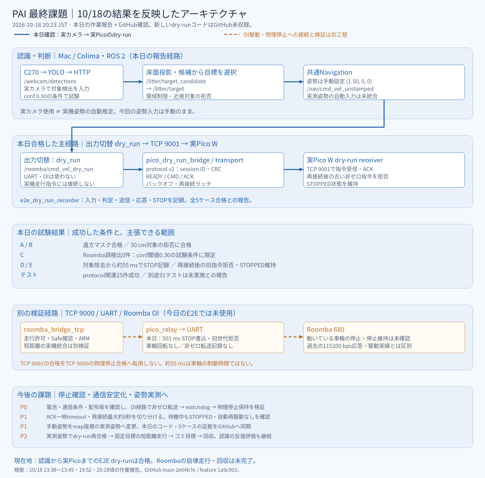
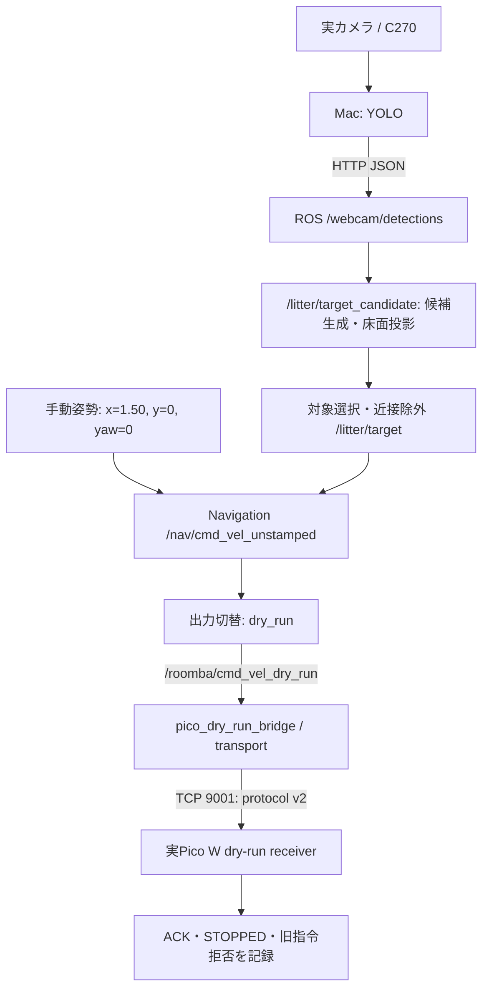

# 現在のアーキテクチャと今後の課題（2026-10-18 20:23 JST）

今日の到達点は、**実カメラ → ROS 2 → TCP 9001 → 実Pico WまでのE2E dry-runの5ケース合格**である。Roomba OIのTCP 9000経路、UART送信、車輪駆動はこの試験では使っていない。STOPはdry-run受信側の停止状態・記録であり、走行中の車輪の物理停止を示す結果ではない。

## 証拠の範囲

| 根拠 | 範囲 |
|---|---|
| GitHub `main` | 10/18確認時 `2e04b7e` |
| GitHub開発ブランチ | `feature/yolo-roomba-dry-run-integration`: `1a9c903`。前回調査`eb74cb1`との差はREADMEのローカルIP表記のみ |
| 10/18 19:52頃・20:18頃のユーザー作業報告 | 実カメラ・ROS 2・実Pico Wでの新しいdry-run経路、protocol v2、5ケースの結果。本追記時点で該当コードは上記GitHub refに未収録 |
| 10/18 13:38〜13:45頃のUART試験報告 | ARM受理、501 ms watchdog STOP・UART書込み、ラッチ後の同世代指令拒否。車輪回転なし、非ゼロDrive転送記録なし |
| 保存済みUART経過・提出レポート | 過去の115200 bps応答、Gazebo接近停止、学習データ、未確認事項の基準 |

本日追加ファイルの存在・結果は作業報告に基づく。今回こちらの実行環境でコード本体・生ログ・実Picoを再実行していない。GitHubにないことを未実装とは扱わず、「本日報告済み・GitHub未収録」と区別する。

## 1. 今日合格した主経路

姿勢は手動設定である。実カメラを使用したことは、実機姿勢を画像やエンコーダーから自動取得したことを意味しない。Navigationの入力・出力経路は今日の報告に従い示したもので、既存のGitHub YAMLの既定出力を変更済みと主張していない。

## 2. 新しい通信・記録の責務

| ファイル（本日報告名） | 担当 |
|---|---|
| `pico/dry_run_protocol.py` | protocol v2、session ID、CRC、READY/CMD/ACKの形式 |
| `pico/cmd_vel_dry_run_receiver.py` | TCP 9001側の受信・検証・停止状態維持。UART/OIを使わないdry-run側 |
| `simulation/dry_run_protocol.py` | ROS側とPico側で整合させるプロトコル形式 |
| `simulation/pico_dry_run_transport.py` | 接続、ACK、再接続・バックオフ、セッション処理 |
| `simulation/pico_dry_run_bridge.py` | ROS Twistをdry-run transportへ渡す境界 |
| `simulation/e2e_dry_run_recorder.py` | 入力・判定・送信・応答・STOPの観測と試験記録 |
| `tests/test_pico_dry_run_protocol.py` | 本日のprotocol関連検証。関連25件成功との報告 |

session ID、CRC/ACK、バックオフ、再接続ラッチを追加したとの報告がある。再接続後の古い非ゼロ指令拒否が試験で確認された。一方、CRCはデータ整合性の確認であり、それだけで物理停止を保証する仕組みではない。protocol v2のコマンド形式とOI TCP 9000の固定フレームを相互に転送しない。

## 3. 本日の試験結果

| ケース | 条件・結果 | 主張できる範囲 |
|---|---|---|
| A | 遠方マスクの確認、合格 | 試験条件内で対象領域の制限が機能 |
| B | 50 cm位置の対象を拒否、合格 | 近接対象を通さないことを確認。すべての距離条件に一般化しない |
| C | confidence閾値0.30でRoomba誤検出0件、条件付き合格 | この閾値・場面に限定。未知場面の誤検出ゼロではない |
| D | 対象除去後、約55 msでSTOP | dry-run経路の停止記録。車輪の制動時間ではない |
| E | 再接続を含む試験、古い非ゼロ指令を拒否 | 実Pico受信側でSTOPPED維持。UART/OIは未使用 |

20:18頃の報告では全5ケース合格。関連25テストは成功。一方、別途31テストは未実施との報告であり、全体の全件合格とはしない。過去の129件・173件・178件等を別環境・別コミットのまま合算しない。

## 4. 実機駆動側は別の検証経路

| 経路 | 状態 |
|---|---|
| ROS → TCP 9001 → Pico dry-run | 本日の主成果。全5ケース合格、STOPPED維持 |
| ROS → TCP 9000 → `pico_relay.py` → UART → Roomba | OI駆動・停止の別経路。本日のE2E dry-runはここを通らない |
| Pico UART | 以前115200 bpsで電池電圧応答を3回取得。現在の電池状態・設定を改めて確認する必要がある |
| OI経路の停止ラッチ | 今日本体側で501 ms STOP書込み・同世代拒否のログあり。ただし車輪が回っておらず、走行からの物理停止は未検証 |
| 実機姿勢 | ローカルオドメトリ取得実績はあるが、今回のE2E入力は手動姿勢。姿勢の実測・ROS接続は残る |
| Gazebo | 既存YOLOで接近・停止の成功実績あり。実機走行試験とは別成果 |

TCP 9001側で再接続ラッチを確認できたことを、TCP 9000側の停止保持合格へ転用しない。両者で共通化できるのは安全設計や試験条件であり、物理出力の合格判定は経路ごとに残す。

## 5. 今後の課題・優先順位

| 優先 | 課題 | 完了条件 |
|---|---|---|
| P0 | 実機の起動・電池・通信条件を再確認 | Roombaの状態、電池、115200 bps成功条件、実際のPico配布版・ロックを記録する |
| P0 | OI経路で停止保持を実測 | 非ゼロDriveが実際に転送されることを確認した限定試験で、watchdog後の旧指令拒否と車輪の停止・停止維持を別々に記録する |
| P1 | ACKタイムアウトと再接続遅延 | ACK一時timeout、最大約8秒の再接続の原因を切り分ける。待機中のSTOPPED維持と自動再駆動なしを再確認する |
| P1 | 姿勢を手動から実測へ | カメラまたはエンコーダーから得る姿勢を目標と同じmap座標へそろえ、古い姿勢・欠測時に停止することを確認する |
| P1 | 新しいコードと結果を版管理へ同期 | 本日のprotocol v2・bridge・receiver・recorder、設定、5ケースのログを同じコミットと結び付ける。未実施31テストの結果を明記する |
| P2 | 同時dry-runから実機へ段階移行 | 実カメラ＋YOLO＋実測姿勢でdry-runを再合格し、固定目標の短距離走行、検出目標への移動、回収動作の順で進める |
| P2 | 認識の評価・再学習 | conf0.30の単一場面に依存せず、缶・紙・PET・背景負例で再評価。準備済み450枚の再学習は比較結果をもって採否を決める |

ACK再接続の約8秒は今回報告された通信復帰の遅延であり、Roombaの停止時間でもPicoの500 ms watchdog設定でもない。通信回復と走行許可の回復を分離し、自動再駆動させない。

## 現在地

**認識から実Pico受信までのdry-runは段階合格。次は、実測姿勢とRoomba OIの物理停止を、今日合格した9001経路と混同せず接続していく段階である。**
