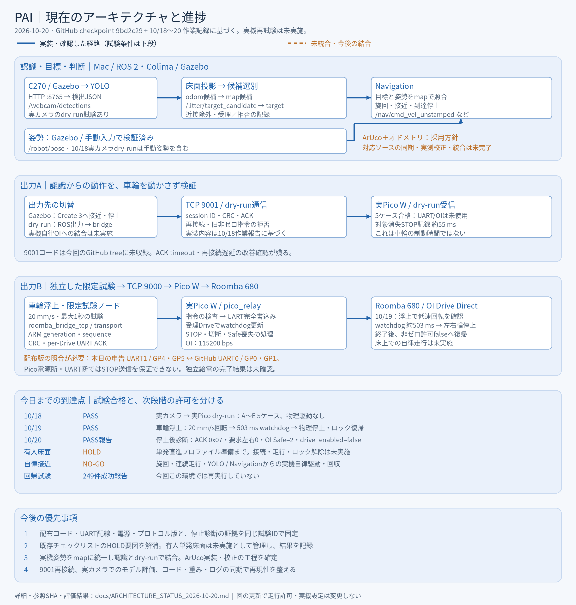
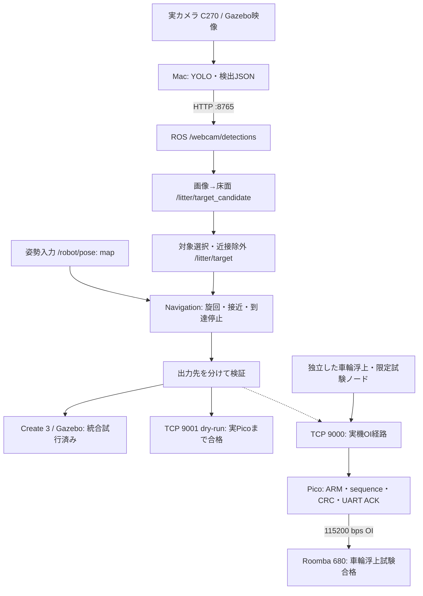

# 現在のアーキテクチャ（2026-10-20 19:24 JST）

**実カメラ→実Picoのdry-runに加え、車輪浮上での低速回転・watchdogによる物理停止まで進んだ。床面走行は未実施・条件付きHOLD、自律接近・回収はNO-GOである。**

## 1. 調査対象と根拠

| 対象 | 参照点・範囲 |
|---|---|
| `main` | `2e04b7e`。従来の公開基準点 |
| 開発ブランチ | `feature/yolo-roomba-dry-run-integration` = `8905290`。物理経路のsequence・CRC・UART ACK、床面試験計画を含む |
| 床面前checkpoint | `checkpoint/yolo-integration-pre-floor-20261020` = `9bd2c29`。開発ブランチより1コミット先。YOLO・候補目標・近接除外・データ生成・評価を保存 |
| 実機結果 | `HARDWARE_INTEGRATION_RUNBOOK.md`、`PHASE4C_SAFETY_REPORT.md`、10/20の作業報告。今回こちらでは実機再試験していない |
| 床面判定 | `ATTENDED_FLOOR_DRIVE_CHECKLIST.md`、`FLOOR_DRIVE_TEST_PLAN.md`。準備・条件の記載を、床面試験の実施結果とは扱わない |
| dry-run | 保存済み10/18日報。TCP 9001側の5ケース合格。関連コードは今回のcheckpointに未収録 |

ArUco関連ファイルや9001通信実装への言及はrunbookにあるが、今回のGitHub treeに対応実装が見当たらない。設計・ローカル作業の記録として示し、チェックイン済み・実測校正済みとはしない。

## 2. 全体の構成

実機OI経路の合格は限定試験ノードからの低速指令に対するもの。図のNavigation→実機OIは今後の結合であり、床面でYOLOがRoombaを自律駆動したという意味ではない。

## 3. 入力・座標・Navigation

checkpointの`vision_controller.yaml`は次の境界を持つ。

| 境界 | 型・意味 |
|---|---|
| `/webcam/detections` | JSON String。候補のラベル・confidence・画素座標 |
| `/litter/target_candidate_odom` | ホモグラフィによるodom床面候補 |
| `/litter/target_candidate` | map_frame_adapterが数値変換したmap候補 |
| `/litter/target` | 近接除外等の判定後に受理したmap目標 |
| `/litter/target_decision` | 受理／拒否の観測境界 |
| `/robot/pose` | map座標のPoseStamped。目標と同じ座標系・鮮度を要求 |
| `/nav/cmd_vel_unstamped` | dry-run用Navigation出力。`dry_run_enabled`が既定false |
| `/cmd_vel_unstamped` | 従来のCreate 3向け出力。モード設定と起動中のpublisherを区別 |

checkpointでは画像サイズ1280×960、`robot_guard_radius=0.5 m`、`max_robot_pose_age=1.0 s`を確認。校正値があることと、そのカメラ配置での実測合格は別である。`control_enabled`と`calibration_ready`の既定falseを維持。

## 4. 出力先ごとの現在地

### シミュレーション

Create 3向けはTwistを`unstamped_cmd_relay.py`でTwistStampedへ変換する。YOLOを含む接近・到達・停止の試行実績がある。これは床面実機の許可や性能保証へ転用しない。

### 実Pico dry-run / TCP 9001

10/18の実カメラ→ROS→Pico E2EはA〜E全5ケース合格。遠方マスク認識、50 cm以内の近接拒否、conf 0.30でのRoomba誤検出0件、対象消失後約55 msのSTOP記録、再接続後の旧非ゼロ拒否とfresh zero後の再開を確認した。UART/OIと車輪は使っていない。

session ID・CRC/ACK・バックオフ・再接続ラッチは作業報告に基づく。ACK timeoutと最大約8秒の再接続遅延は、改善済みという追加の確定結果がなく残課題として保持する。

### Roomba OI / TCP 9000

`roomba_bridge_tcp.py` → `roomba_tcp_transport.py` → `pico_relay.py` → OI Drive Direct。

最新版コードでは、走行ARM generationに加えて単調増加sequence、CRC、per-Drive ACKを確認した。ホストはACKのgeneration/sequenceとUART書込み結果を確認する。PicoはCRC・sequenceを検査し、UARTへ完全書込みできたDriveだけでwatchdogを更新する。通常STOP、切断、watchdog、Safe喪失等の扱いを層ごとに持つ。

10/19のrunbookには、安定台上の左右20 mm/s・最大1秒、Drive sequence 1/2、UART ACK、503 ms watchdog STOP、左右輪の物理停止、終了後`ALLOW_NONZERO_DRIVE=False`復帰の合格記録がある。10/20にはTCP再接続後のSTOP ACK 0x07、要求左右速度0、OI Safe=2、ROS側drive_enabled=falseの診断PASS報告がある。個々の結果と日付を分け、10/20に床面走行したとはしない。

STOP ACK 0x07や要求速度0だけを物理停止の証拠にせず、車輪浮上の目視停止結果を別の証拠として扱う。TCP 9000は制御とACKの経路であり、Picoコンソールログがすべて流れるわけではない。

## 5. 姿勢推定は「採用方針・未統合」

- 現在のシミュレーション姿勢はmap_frame_adapterが供給する。10/18 dry-runは手動姿勢を含む条件。
- 有線ドライバ側にはエンコーダー取得・オドメトリ計算の実績があるが、実機用`/robot/pose`の供給・座標校正・一貫した自律走行への結合は未完了。
- ArUco＋オドメトリは採用方針。runbookには`/robot/pose_candidate`、`/localization/aruco_pose`、模擬エンコーダー、wheel_odom、map→odom融合の設計がある。
- 対応するArUco・融合ソースが今回のGitHub treeにないため、実装済み・回帰合格・実測精度合格とは表記しない。
- カメラ高さ・マーカー高さ・取付け位置・yaw補正・未使用点での精度確認が残る。mapの姿勢publisherは承認した一系統だけにする。

ArUcoを最小デモの必須工程にするかは別の作業判断。今回の図では未統合の拡張経路とし、床面限定直進試験の入力に接続しない。

## 6. 配布版とリポジトリの差

| 項目 | 現在確認できるもの |
|---|---|
| GitHubのOIリレー | UART0 / GP0・GP1、BRC GP2、115200 bps、Pico非ゼロ許可false |
| 本日のユーザー構成 | UART1 / GP4・GP5を使用との発言あり。今回配布コードの本体・安定通信試験結果は未取得 |
| モバイルバッテリー給電 | 独立試験の証拠取得方針はあるが、完了結果としては未確認 |
| プロトコル | 9000のOI用固定プロトコルと9001 dry-run用プロトコルを別物として版管理する |

したがって配線やポートを一方へ書き換えた図にはせず、**現物の配布版を確認して一致させる必要がある差分**として残す。通信成功をレベル変換や全電源条件の安全性確認と同一視しない。

## 7. 進捗とGo/Holdを分ける

| 段階 | 判定 | 範囲 |
|---|---|---|
| 実カメラ→実Pico dry-run | PASS報告 | TCP9001の5ケース。物理駆動なし |
| Phase 4B車輪浮上 | PASS記録 | 20 mm/s・1秒以内。回転、watchdog503 ms、物理停止、ロック復帰 |
| 10/20停止後診断 | PASS報告 | ACK0x07、要求左右0、Safe2、drive_enabled=false |
| 有人限定床面Stage 2 | **条件付きHOLD** | 計画・プロファイル準備のみ。床面接続・走行・ロック解除は未実施 |
| 旋回・連続走行・Navigation／YOLO自律 | **NO-GO** | 今回の有人単発直進試験の対象外 |
| ArUco＋オドメトリ | 方針・設計、未統合 | 実機姿勢の自動供給・実測校正は未完了 |

249件の回帰成功は10/20作業報告の結果として記録する。今回この環境では同じ版・依存関係で再実行しておらず、過去の件数と合算しない。

有人限定床面プロファイルは、左右各+20 mm/s、最大1.0秒、指令上0.020 m、1 ARM generationごと1回、直進のみ。これは**計画の上限**であって、床面で20 mm移動した実績ではない。実施には既存チェックリストの条件充足と当日の判断が必要で、今回その承認や操作は行わない。

## 8. 学習・モデルの現在地

10/18時点の「450枚は準備のみ」という説明を、そのまま最新コード全体へ適用しない。checkpointにはデータ生成・Colab export・評価ツールと、3モデルのdomain別評価表が保存されている。

`artifacts/pai_output_validation/REPORT.md`では、Gazebo mAP50は旧TACOモデル0.658に対しmixed0.995。一方、TACO mAP50は旧0.591に対しmixed0.476で、仮想環境への適合が実画像性能を改善したとは限らない。実Webカメラの採用重み・SHA・独立holdoutでの比較を確定する工程が残る。評価表の追加と、現場での採用モデル切替は区別する。

## 9. 今後の課題（順序案）

1. **配布版と当日状態を固定**：UART1という現物の申告とGitHub UART0の差、電源、baud、プロトコル、試験後ロック、STOP診断の証拠を同じ試験IDへまとめる。
2. **有人単発床面試験のHOLD要因を解消**：既存のStage 0/1再確認、担当者・閉鎖区域・封じ込め・停止操作・電池状態等をチェックする。実施済みにせず、HOLD解除の結果を記録する。自律制御は接続しない。
3. **実距離・停止・方向の記録**：床面試験を別途実施できた場合だけ、エンコーダーと実測距離、停止、再始動なし、ロック復帰を同一記録で評価する。
4. **電源断・UART断の残留リスクを整理**：Picoが送信不能になると新たなSTOPを出せない。浮上試験PASSをこの条件の独立停止保証へ拡大しない。走行中の抜線をこの図から実行することは提案しない。
5. **姿勢と認識を段階結合**：実測姿勢をmapにそろえた同時dry-runを確認し、その後に別段階の床面制御へ進む。ArUcoの新規実装を追加するかは工程と安定性で判断する。
6. **通信と提出物の再現性**：9001のACK／再接続改善、ソース・配布版・モデルhash・各試験動画とログを同期する。Pico独立給電時は、ROS ARM/STOP/ACK・物理動画・停止後診断を組み合わせ、コンソールがないことを試験失敗と即断しない。

本更新は構成図と記録のみ。走行ロック、実機の配線、Picoへの配布、試験実行は変更していない。
